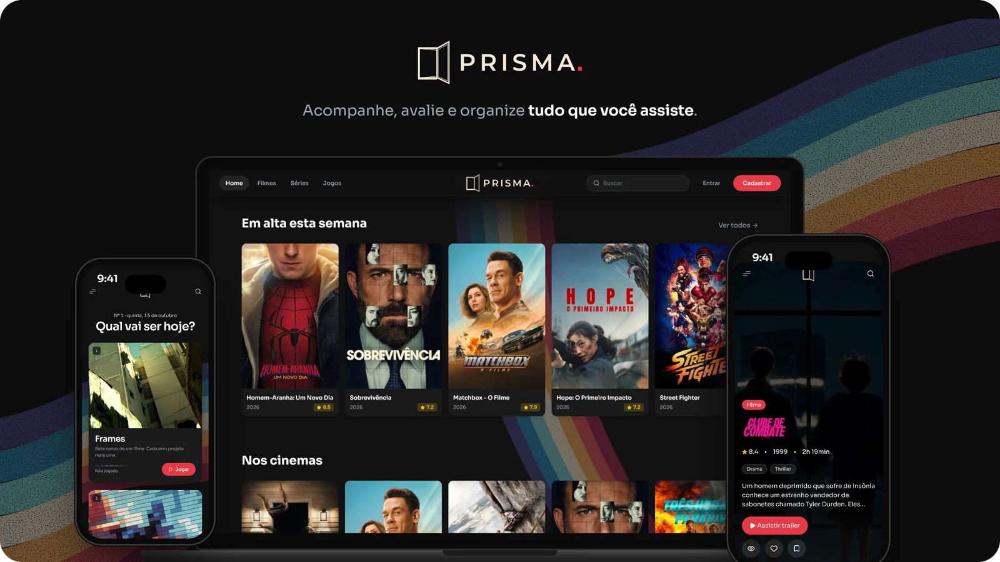
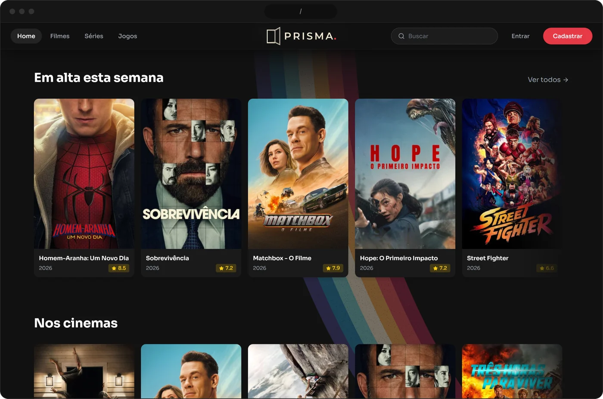
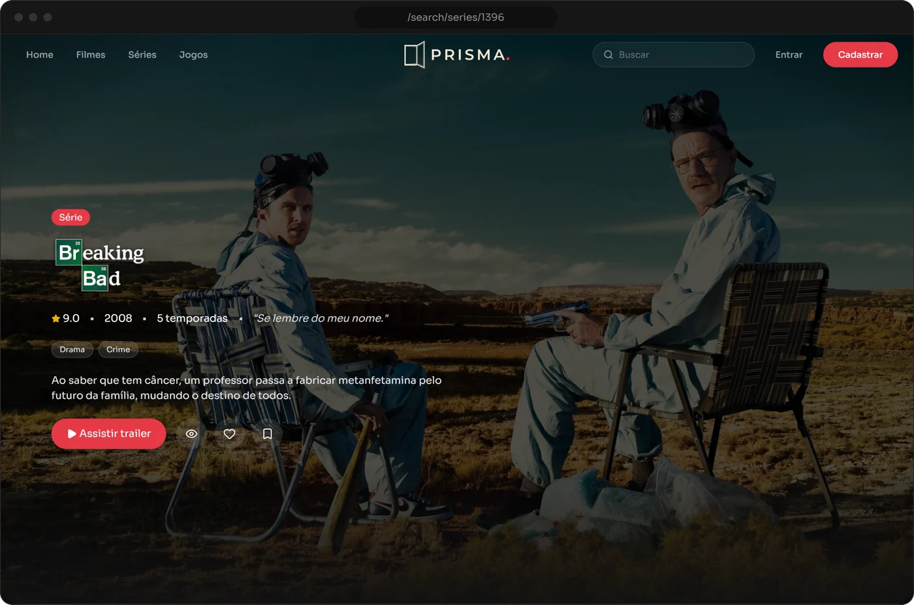
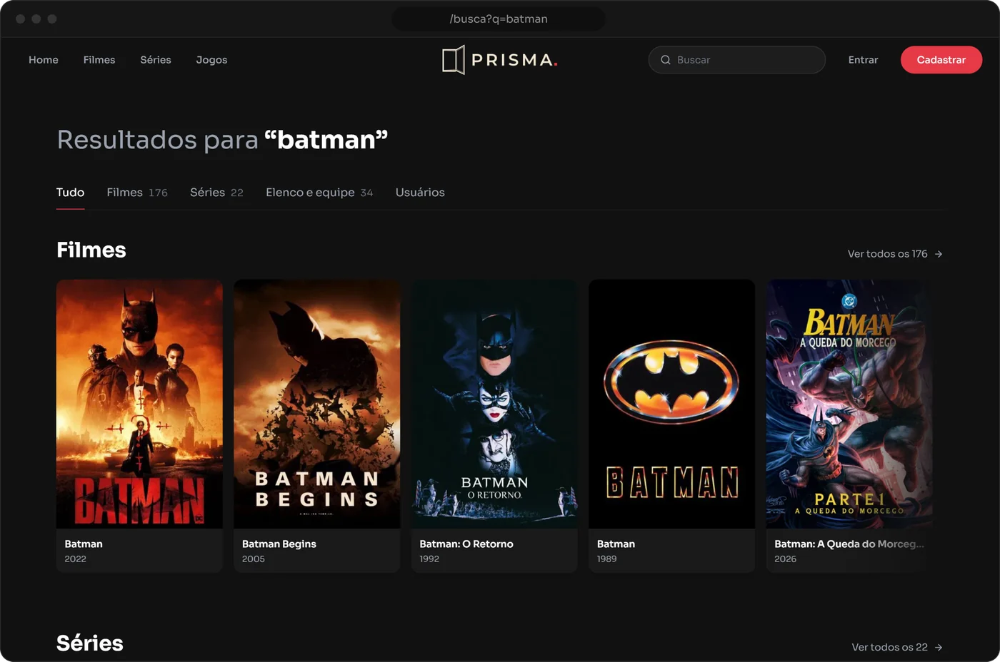
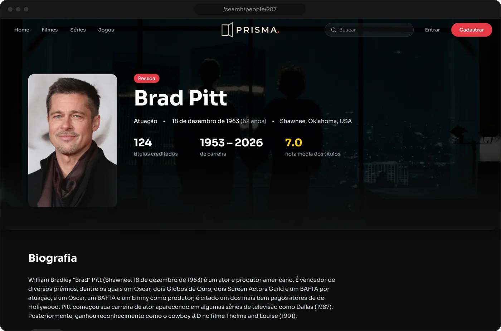
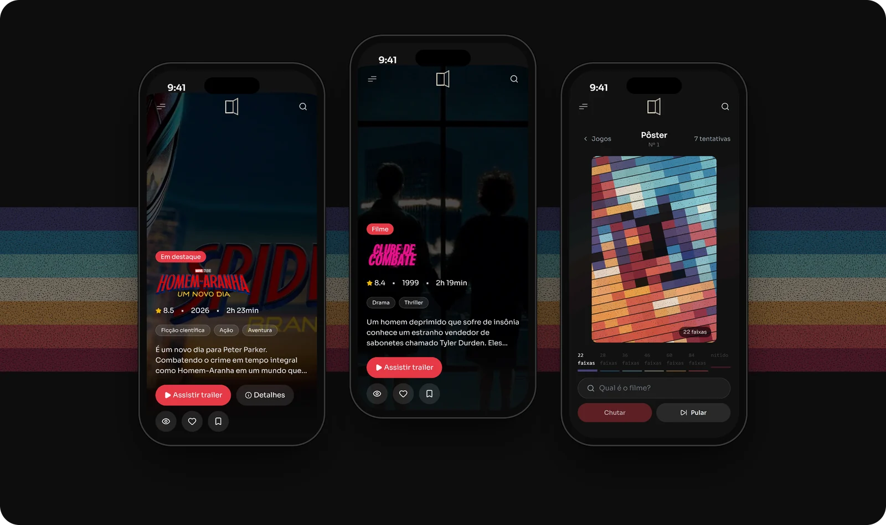
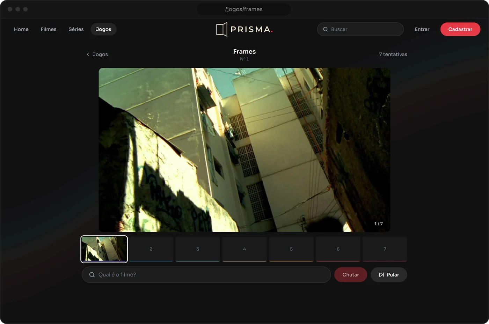
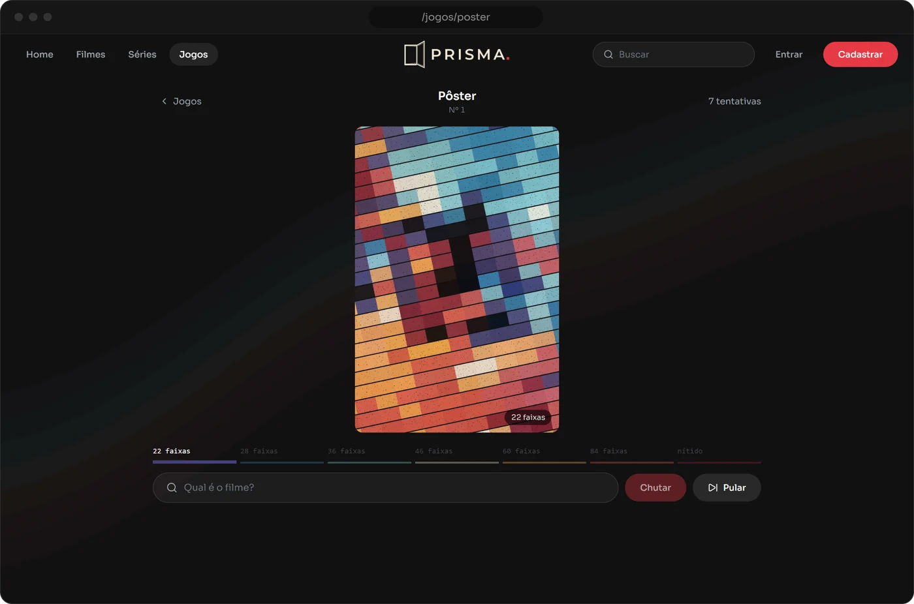
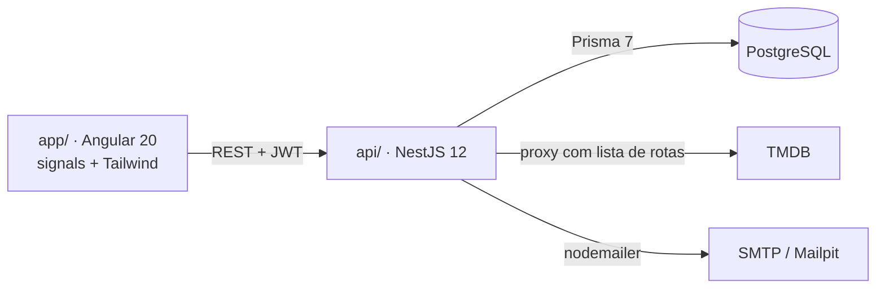

<p align="center">
  
</p>

<p align="center">
  <b>Acompanhe, avalie e organize tudo que você assiste.</b><br>
  Catálogo de filmes e séries com diário, notas, watchlist, perfil social e jogos diários.
</p>

<p align="center">
  
  
  
  
  
  
  
</p>

<p align="center">
  <a href="#telas">Telas</a> ·
  <a href="#funcionalidades">Funcionalidades</a> ·
  <a href="#jogos">Jogos</a> ·
  <a href="#arquitetura">Arquitetura</a> ·
  <a href="#rodando-localmente">Rodando localmente</a> ·
  <a href="#estrutura">Estrutura</a>
</p>


## Sobre

O **Prisma** é um diário de cinema e TV. Os dados de
filmes, séries e pessoas vêm da [TMDB](https://www.themoviedb.org/); em cima deles o Prisma
guarda o que é seu: o que você assistiu, a nota que deu, o que quer ver, quem você segue.

O visual parte da marca: a janela da logo se abre e o feixe de sete cores sai dela. Essas
cores aparecem em poucos lugares, como a barra de carregamento, os avisos e os jogos. No
resto da interface fica o que importa, pôster grande e tipografia sóbria.

## Telas

<table>
  <tr>
    <td width="50%"></td>
    <td width="50%"></td>
  </tr>
  <tr>
    <td align="center"><sub><b>Home</b> · destaque rotativo com trailer e fileiras por assunto</sub></td>
    <td align="center"><sub><b>Detalhes</b> · ficha, elenco, temporadas, onde assistir e avaliações</sub></td>
  </tr>
  <tr>
    <td width="50%"></td>
    <td width="50%"></td>
  </tr>
  <tr>
    <td align="center"><sub><b>Busca</b> · filmes, séries, elenco e usuários (<code>@nome</code>)</sub></td>
    <td align="center"><sub><b>Pessoa</b> · biografia, números da carreira e "conhecido por"</sub></td>
  </tr>
</table>

### No celular

Toda tela é pensada para celular, tablet e desktop, e conferida em 375, 768, 1024 e 1440 px.
No toque, os carrosséis deslizam, a busca abre sobre a navbar e os modais sobem de baixo.

<p align="center">
  
</p>

## Funcionalidades

**Catálogo**
- Home com destaque rotativo, que troca com swipe no celular e toca o trailer em tela cheia.
- Fileiras de em alta, nos cinemas, populares, séries e recomendados.
- Filmes e séries com filtro por gênero e grade com carregamento contínuo.
- Página de detalhes com sinopse, ficha técnica, elenco, galeria, temporadas, onde assistir, títulos similares, nota da TMDB e nota do Prisma.
- Busca instantânea na navbar, com navegação pelo teclado.

**Conta e perfil**
- Avaliação com nota de 1 a 10, texto, curtida e data em que assistiu.
- Atalhos de assistido, curtido e watchlist em qualquer card.
- Perfil público (`/username/:username`) com capa, quatro favoritos e as abas Geral, Diário (por mês), Avaliações e Watchlist.
- Seguir e deixar de seguir, com listas de seguidores e seguindo e aviso de seguidor novo.
- Configurações de perfil (foto, nome, bio, capa) e de conta (e-mail, senha e sessões).

**Segurança**
- Senha com argon2. Access token JWT de 15 min e refresh token rotativo em cookie `httpOnly`. Um refresh token revogado que aparece de novo derruba todas as sessões.
- Troca de e-mail confirmada com código de 6 dígitos enviado ao endereço novo. O código fica salvo como HMAC, vale 15 min e aceita 5 tentativas.
- Mudar a senha ou o e-mail reinicia todas as outras sessões.
- Rate limit por rota, `helmet` e proxy da TMDB com lista de rotas permitidas. A chave da TMDB nunca chega ao navegador.

## Jogos

Todo dia sai um desafio de cada jogo, o mesmo para todo mundo, e ele vira à meia-noite de
Brasília. São sete tentativas, e pular também conta como uma. A resposta fica no servidor:
a API só entrega as imagens que você já liberou.

<table>
  <tr>
    <td width="50%"></td>
    <td width="50%"></td>
  </tr>
  <tr>
    <td valign="top"><b>Frames</b><br><sub>Sete cenas do filme, da mais difícil para a mais fácil. A cada erro aparece a próxima.</sub></td>
    <td valign="top"><b>Pôster</b><br><sub>O pôster, sem texto, redesenhado em listras com as cores da marca. A cada erro as faixas afinam e a cor real volta.</sub></td>
  </tr>
</table>

Quem está logado tem a partida salva na conta, com sequência e distribuição de acertos. Sem
login, ela fica no aparelho. No fim aparece um resumo para compartilhar.

## Arquitetura



| | |
|---|---|
| **Front** | Angular 20 standalone, signals, RxJS, Tailwind 3, Lenis (rolagem suave), Lucide, fonte Sora |
| **API** | NestJS 12, Prisma 7 (`adapter-pg`), class-validator, argon2, helmet, throttler, sharp (foto do perfil vira WebP sem metadados), nodemailer |
| **Dados** | PostgreSQL. Os títulos da TMDB ficam espelhados localmente e são atualizados a cada 7 dias |
| **Testes** | Vitest + supertest na API (e2e com carteiro falso no lugar do SMTP), Karma/Jasmine no front |

## Rodando localmente

**Pré-requisitos:** Node 20.19+, um PostgreSQL rodando e uma [chave da API da TMDB](https://www.themoviedb.org/settings/api).
O [Mailpit](https://mailpit.axllent.org/) é opcional e serve para ver os e-mails no desenvolvimento.

```bash
git clone https://github.com/oBrunoz/spectral.git prisma
cd prisma
```

**API** (porta 3000)

```bash
cd api
npm install
cp .env.example .env          # preencha DATABASE_URL, JWT_SECRET (32+ caracteres) e TMDB_API_KEY
npx prisma migrate dev        # cria as tabelas
npx prisma generate           # gera o client em src/generated/prisma
npm run jogos:importar        # carrega os desafios dos jogos
npm run start:dev
```

**App** (porta 4200)

```bash
cd app
npm install
npm start
```

Abra http://localhost:4200. Com o Mailpit rodando, os e-mails de confirmação chegam em
http://localhost:8025.

<details>
<summary><b>Variáveis do <code>api/.env</code></b></summary>

| Variável | Para quê |
|---|---|
| `DATABASE_URL` | conexão do PostgreSQL |
| `JWT_SECRET` | assinatura dos tokens (mínimo 32 caracteres) |
| `TMDB_API_KEY` | chave da TMDB, usada só no servidor |
| `CORS_ORIGIN` | origem do app (`http://localhost:4200`) |
| `SMTP_HOST` `SMTP_PORT` `SMTP_USER` `SMTP_PASS` `MAIL_FROM` | envio de e-mail (Mailpit: `localhost:1025`, sem usuário) |

</details>

### Testes

```bash
cd api
npm test            # unitários
npm run test:e2e    # ponta a ponta: auth, conta, perfil, follow, reviews, jogos, segurança…

cd ../app
npx ng build --configuration development   # valida template e tipos
```

## Estrutura

```
app/                      front-end Angular
  src/app/
    core/                 services, guards, interceptors, modelos
    features/             home, movies, series, details, person, resultados,
                          usuario, configuracoes, jogos, login, register
    shared/               navbar, carousel-row, hero, toast-roll, travessia, logo…
  public/brand/           logo, ícones e as listras da marca
api/                      back-end NestJS
  src/                    auth, account, user, follow, review, watchlist,
                          media, tmdb, games, mail, health
  prisma/                 schema, migrations e desafios dos jogos
  test/                   suítes e2e
docs/readme/              imagens deste README
```


<p align="center">
  <br>
  <sub>Dados de filmes e séries fornecidos pela <a href="https://www.themoviedb.org/">TMDB</a>.
  Este projeto usa a API da TMDB, mas não é endossado nem certificado por ela.</sub>
</p>
